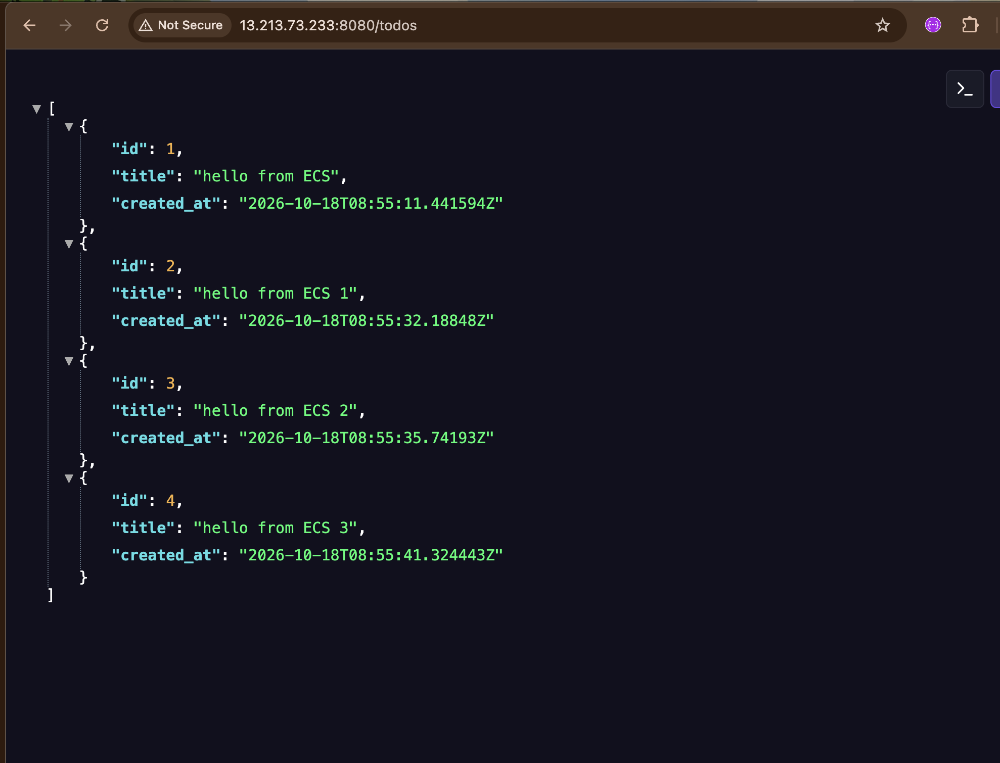
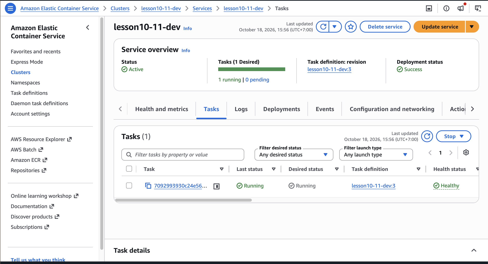
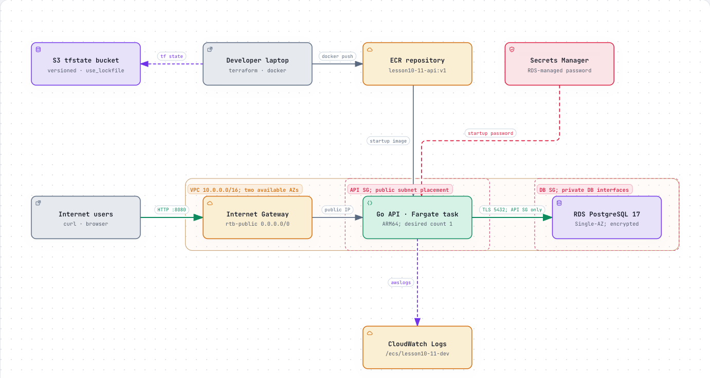

# Lesson 10–11: Go API + PostgreSQL on AWS

**Assignment:** Build an API connected to a database, deploy the API to ECS and the database to RDS, and submit the ECS public endpoint and an architecture diagram.

## Result

Verified on **18 October 2026**:

- **API:** [GET /todos](http://13.213.73.233:8080/todos) returned four successfully created todos.
- **Health:** `/health` returned `ok`; `/ready` returned `ready`, confirming database connectivity.
- **ECS:** `lesson10-11-dev` deployed successfully with one healthy Fargate task (`lesson10-11-dev:3`).

## Architecture

Terraform provisions:

- **API:** One public ARM64 Fargate task serving the Go API on port 8080.
- **Database:** Private, encrypted RDS PostgreSQL 17; port 5432 accepts traffic only from the API security group.
- **Images and secrets:** ECR stores the image; Secrets Manager supplies the database password at startup.
- **Logs and state:** CloudWatch collects logs; S3 stores dev Terraform state with locking.

See [quickstart.md](quickstart.md) for local development and AWS deployment.
