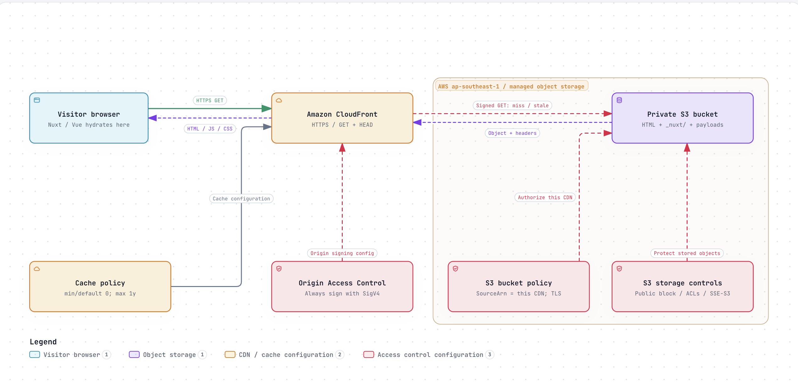

# Lesson 12: Nuxt on private S3 and CloudFront

> [!NOTE]
> CloudFront serves the default Nuxt welcome page over HTTPS. S3 stays private, and Origin Access Control (OAC) signs CloudFront’s requests to S3.
>
> Terraform provisions the infrastructure; pnpm generates the static files; the AWS CLI uploads them.

- **[Start with the quickstart](quickstart.md)**
- [App notes](nuxt-app/README.md)
- [Cleanup](quickstart.md#5-cleanup)

## Architecture

**Browser → CloudFront → Private S3**

Nuxt generates `nuxt-app/.output/public/` locally. CloudFront serves the uploaded files; no application server runs in AWS.

**Routing:** Only `/` maps to `index.html`. Nested page URLs need a CloudFront rewrite.

## Deployment evidence

**Recorded:** October 20, 2026 · **Nuxt:** 4.6.2 · **Region:** `ap-southeast-1`

| Check | Result |
| --- | --- |
| Terraform apply | 8 added, 0 changed, 0 destroyed |
| CloudFront website | Default Nuxt welcome page loaded |
| HTTPS `/` | `200`, HTML, `Cache-Control: no-cache` |
| HTTP `/` | `301` redirect to HTTPS |
| Anonymous S3 access | `403 Forbidden` |

Account and resource identifiers are masked.

### Nuxt website

### CloudFront origin

### S3 static files

> [!CAUTION]
> AWS resources incur charges until removed. Follow the [cleanup steps](quickstart.md#5-cleanup) when finished. The dev example enables `force_destroy`, so destroying the bucket permanently deletes its contents.
