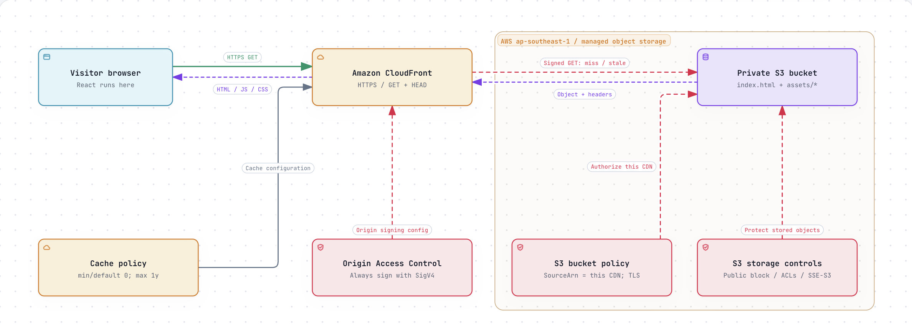
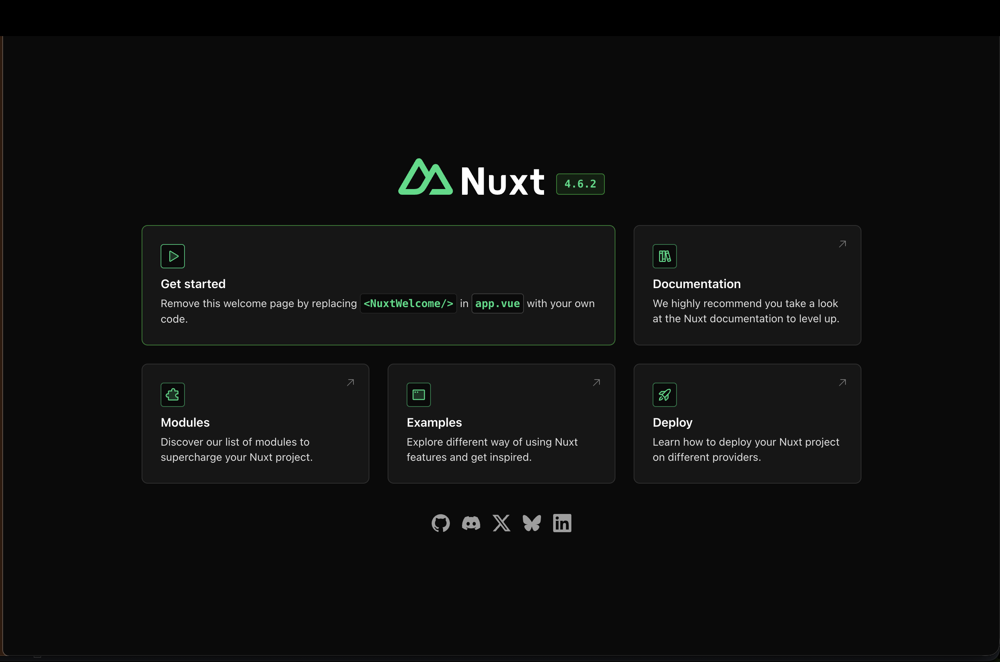
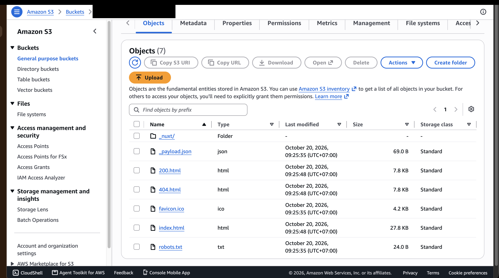
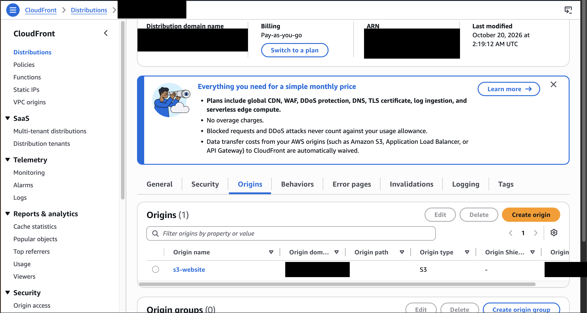

# Lesson 12: React on private S3 and CloudFront

**Goal:** Host a React/Vite website over CloudFront HTTPS with a private S3 origin. Terraform creates the infrastructure; the AWS CLI uploads the build.

Start with the [quickstart](quickstart.md) for local development, deployment commands, verification, and cleanup.

## Architecture



- **Delivery:** CloudFront redirects HTTP to HTTPS and reads S3 through signed Origin Access Control (OAC) requests.
- **Storage:** S3 stores the build with encryption, public access blocked, and a bucket policy restricting CloudFront reads to this distribution.
- **Caching:** Hashed assets use one-year immutable caching; HTML and stable public files require revalidation. The root `/` serves `index.html`; browser-history route fallback is not configured.

## Result

- **Website:** [Open the deployed app](https://d2w09l92ojbxvw.cloudfront.net). The page loaded successfully and the counter reached `6`.
- **Infrastructure:** Terraform applied successfully in `ap-southeast-1`: **8 added, 0 changed, 0 destroyed**.

The website link remains available while the lab is deployed. See the [cleanup steps](quickstart.md#5-cleanup) when finished to avoid ongoing charges.

## Evidence

Terraform test excerpt (mocked AWS; no real resources created):

```text
$ terraform -chdir=terraform/environments/dev test
  run "private_bucket"... pass
  run "https_spa"... pass
  run "bucket_policy"... pass

Success! 3 passed, 0 failed.
```

AWS account details and internal resource identifiers are masked in the console screenshots.






