# Lesson 14: E-commerce microservices on AWS

A small online shop split into six Go microservices on ECS Fargate, with a Nuxt storefront, Cognito sign-in, an event-driven order flow on SNS/SQS, PostgreSQL and DynamoDB, all behind one CloudFront distribution with WAF. Terraform deploys everything, with state in S3.


- **[Quickstart](quickstart.md)**: setup, local run, offline checks, deploy, verify, cleanup
- **[Test cases](testcases.md)**: 11 scenarios on the live stack (failures, abuse, masked logs, release), each with steps, expected result and last result
- **[Local guide](docs/README.md)** (gitignored, local copies only): how each AWS service and the order flow work
- Modules: [state-bucket](terraform/modules/state-bucket/README.md) · [network](terraform/modules/network/README.md) · [ecr](terraform/modules/ecr/README.md) · [ecs-cluster](terraform/modules/ecs-cluster/README.md) · [ecs-service](terraform/modules/ecs-service/README.md) · [alb-internal](terraform/modules/alb-internal/README.md) · [api-gateway](terraform/modules/api-gateway/README.md) · [cognito](terraform/modules/cognito/README.md) · [rds-postgres](terraform/modules/rds-postgres/README.md) · [dynamodb-table](terraform/modules/dynamodb-table/README.md) · [messaging](terraform/modules/messaging/README.md) · [s3-cloudfront](terraform/modules/s3-cloudfront/README.md) · [waf](terraform/modules/waf/README.md) · [observability](terraform/modules/observability/README.md)

## Deliverables

| # | Deliverable | Section |
| --- | --- | --- |
| 1 | Overall AWS architecture diagram | [1. Architecture](#1-architecture) |
| 2 | VPC, subnet and security-group design | [2. Network design](#2-network-design-vpc-subnets-security-groups) |
| 3 | The role of each AWS service | [3. AWS services and their roles](#3-aws-services-and-their-roles) |
| 4 | The flow when a customer places an order | [4. Order flow](#4-order-flow) |
| 5 | How the design handles high availability, scalability and security | [5. High availability, scalability and security](#5-high-availability-scalability-and-security) |
| | Proof that it runs: screenshots and logs from the live deployment | [6. Live deployment evidence](#6-live-deployment-evidence) |

## 1. Architecture

**Browser → CloudFront + WAF → (S3 storefront · S3 images · API Gateway → VPC Link → internal ALB) → six ECS Fargate services → RDS PostgreSQL · DynamoDB · SNS/SQS · Cognito · SES**

![Lesson 14 architecture. The browser reaches CloudFront, which has a WAF web ACL attached. CloudFront serves the storefront and images from two private S3 buckets through origin access control, and forwards /api/* with an X-Origin-Verify header to an API Gateway HTTP API. API Gateway verifies JWTs issued by Cognito and forwards through a VPC Link to an internal ALB in the private subnets of two availability zones. The ALB path-routes to the user, product, order, payment and cart services on ECS Fargate. Notification is a queue worker with no route. User, product, order and payment store data in one RDS PostgreSQL instance with a schema per service. Cart uses a DynamoDB table. Order and payment publish to and poll the order-events SNS topic and its SQS queues. Notification receives all three events and sends email through SES. User calls Cognito to sign up and sign in.](images/aws-architecture.png)

- **Edge:** CloudFront is the only public entry point. It serves `/` and `/images/*` from private S3 buckets and sends `/api/*` to API Gateway. WAF uses AWS managed rules and a per-IP rate limit.
- **API:** an API Gateway HTTP API with stage throttling and a Cognito JWT authorizer. On protected routes it sets the `X-Customer-*` identity headers from the token's claims, so services can trust them.
- **Private origin:** services have no public address. The ALB forwards only requests that carry CloudFront's secret `X-Origin-Verify` header and returns 403 for everything else.
- **Services:** `user`, `product`, `cart`, `order`, `payment` and `notification` run on ARM64 Fargate. Each has its own IAM role, security group and CPU autoscaling from 1 to 4 tasks, and a failed rolling deploy rolls back automatically.
- **Data:** one RDS PostgreSQL instance with a schema and role per service, plus a DynamoDB cart table.
- **Events:** checkout creates a `PENDING_PAYMENT` order. `OrderCreated` → Payment → `PaymentSucceeded`/`PaymentFailed` → Order and Notification, through SNS and one SQS queue (with a DLQ) per consumer.

Not drawn: ECR, Secrets Manager, CloudWatch, and the one-off `db-init` task that creates the schemas and roles. The NAT path is shown in the network diagram below.

## 2. Network design (VPC, subnets, security groups)

![Lesson 14 network. The VPC 10.0.0.0/16 spans AZ a and AZ b. The public subnets 10.0.1.0/24 and 10.0.2.0/24 hold one NAT gateway (in AZ a) behind the internet gateway. The private subnets 10.0.11.0/24 and 10.0.12.0/24 hold the VPC Link ENIs, the internal ALB, the six service task security groups, the db-init task and RDS. The VPC Link reaches the ALB on TCP 80. The ALB reaches the five web services on TCP 8080. User, product, order, payment and db-init reach RDS on TCP 5432. Notification has no ingress. Private route tables send 0.0.0.0/0 to the NAT, and AWS APIs such as ECR, Secrets Manager, CloudWatch, SNS, SQS, DynamoDB, Cognito and SES are reached over HTTPS through the NAT and the internet gateway.](images/vpc-network.png)

**VPC `10.0.0.0/16` in `ap-southeast-1`, across two availability zones:**

| Subnet | AZ a | AZ b | What runs there | Route `0.0.0.0/0` |
| --- | --- | --- | --- | --- |
| Public | `10.0.1.0/24` | `10.0.2.0/24` | NAT gateway (one, in AZ a, when `single_nat_gateway = true`) | Internet gateway |
| Private | `10.0.11.0/24` | `10.0.12.0/24` | VPC Link ENIs, internal ALB, all Fargate tasks, RDS | NAT gateway (one private route table per AZ) |

Nothing that serves traffic has a public IP. Fargate tasks get no public address, RDS is not publicly accessible, and the ALB is `internal`. CloudFront, API Gateway, Cognito and the other AWS APIs sit outside the VPC. Tasks reach the AWS APIs over HTTPS through the NAT, because the lab adds no VPC endpoints.

**Security groups (least privilege between tiers):**

| Security group | Inbound | Outbound |
| --- | --- | --- |
| VPC Link | none | TCP 80 to the ALB SG |
| Internal ALB | TCP 80 from the VPC CIDR `10.0.0.0/16` | TCP 8080 to the VPC CIDR |
| `user`, `product`, `cart`, `order`, `payment` tasks (one SG each) | TCP 8080 from the ALB SG only | all (AWS APIs via NAT) |
| `notification` task | none (it is a queue worker) | all |
| `db-init` task (one-off) | none | all |
| RDS PostgreSQL | TCP 5432 from the `user`, `product`, `order`, `payment` and `db-init` SGs only | none |
| VPC default SG | managed with no rules | none |

`cart` and `notification` have no route to the database at all: cart uses DynamoDB, and notification has no store.

## 3. AWS services and their roles

| Layer | Service | Role in this system |
| --- | --- | --- |
| Edge | **CloudFront** | The single public HTTPS entry point (HTTP redirects to HTTPS). It caches and serves the storefront and product images, and forwards `/api/*` to API Gateway with the secret `X-Origin-Verify` header. |
| Edge | **AWS WAF** | A web ACL on the distribution: `AWSManagedRulesCommonRuleSet`, `AWSManagedRulesKnownBadInputsRuleSet`, and a rate-based rule (2,000 requests per 5 minutes per IP). |
| Edge | **S3** (×2) | Private buckets for the static Nuxt storefront and the product images. They are encrypted, block all public access and are readable only by CloudFront through origin access control (OAC). |
| Identity | **Cognito** | A user pool and web client. It handles sign-up and sign-in (called by the `user` service) and issues the JWTs that API Gateway verifies. |
| API | **API Gateway (HTTP API)** | Public vs protected routes, a JWT authorizer, stage throttling (50 rps, burst 100), and identity mapping: protected routes overwrite `X-Customer-Sub`/`X-Customer-Email` from the token, and public routes strip them. |
| API | **VPC Link** | Carries API Gateway traffic into the private subnets without exposing the ALB to the internet. |
| Network | **VPC, subnets, IGW, NAT gateway** | Isolation across two AZs: public subnets for NAT only, private subnets for everything else, and outbound internet for the tasks through NAT. |
| Compute | **Elastic Load Balancing (internal ALB)** | Path-based routing (`/api/users*`, `/api/products*`, `/api/cart*`, `/api/orders*`, `/api/payments*`), each rule also requiring `X-Origin-Verify`, plus health checks across both AZs. Order also calls Cart and Product through it. |
| Compute | **ECS on Fargate** | Runs the six ARM64 services without managing servers: rolling deploys with a circuit breaker and rollback, CPU target-tracking autoscaling, and one task role per service. It also runs the one-off `db-init` task. |
| Compute | **ECR** | One repository per image (6 services + `db-init`), with immutable tags and scan on push. |
| Data | **RDS PostgreSQL** | Relational data for `user`, `product`, `order` and `payment`, one schema and login role per service. Storage is encrypted, the master password is managed by RDS in Secrets Manager, and `multi_az` is an opt-in standby. |
| Data | **DynamoDB** | The cart table: one item per customer, on-demand capacity, point-in-time recovery, encryption at rest and TTL so abandoned carts expire. |
| Messaging | **SNS** | The `order-events` topic. Each message carries an `event_type` attribute (`OrderCreated`, `PaymentSucceeded`, `PaymentFailed`). |
| Messaging | **SQS** | One queue per consumer, subscribed with a filter policy (payment: `OrderCreated`; order: payment outcomes; notification: all three), each with a dead-letter queue after 5 receives. |
| Messaging | **SES** | Sends the order emails from the `notification` service (falls back to log mode when no sender is configured). |
| Security | **Secrets Manager** | Holds the `X-Origin-Verify` secret, the per-service DB passwords and the RDS master password. ECS injects them at task start. |
| Security | **IAM** | One execution role and one task role per service, each limited to that service's own table, topic, queue or Cognito action. |
| Operations | **CloudWatch** | Logs (7-day retention), Container Insights, a dashboard, and alarms on ALB/API Gateway 5xx rate, ALB p95 latency, under-desired task counts, non-empty DLQs, and RDS CPU and connections. Alarms notify an SNS email topic. |
| Operations | **S3 (Terraform state)** | A versioned, encrypted bucket created by `terraform/bootstrap` that holds the remote state, with S3-native locking. |

## 4. Order flow

Checkout has a **synchronous part**, which turns the cart into a priced `PENDING_PAYMENT` order and returns `201` straight away, and an **asynchronous part**, in which Payment decides and Order and Notification react to events.

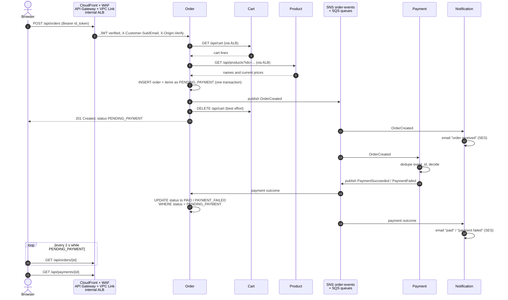

1. **Request.** The logged-in customer clicks *Place order*. The storefront sends `POST /api/orders` with the Cognito ID token and no body, because the order is built from the server-side cart.
2. **Entry path.** WAF checks the request. CloudFront adds `X-Origin-Verify`. API Gateway validates the JWT and sets `X-Customer-Sub`/`X-Customer-Email` from its claims. The VPC Link and the ALB rule `/api/orders*` deliver it to an Order task.
3. **Read the cart and prices.** Order calls Cart and Product through the internal ALB (with the secret header). An empty cart returns `422`, and so does an unknown product.
4. **Store the order.** Order prices every line at the current product price and inserts `orders` and `order_items` in one PostgreSQL transaction, with status `PENDING_PAYMENT`.
5. **Publish and answer.** Order publishes `OrderCreated` to SNS, clears the cart (best effort) and returns `201 Created`. The storefront opens the order page.
6. **Fan-out.** SNS delivers `OrderCreated` to the payment and notification queues. Notification emails *order received*.
7. **Payment.** Payment deduplicates on `event_id`, decides (demo rule: a total ending in `99` cents is declined), publishes `PaymentSucceeded` or `PaymentFailed` and stores a `payments` row.
8. **Finish the order.** Order moves the order to `PAID` or `PAYMENT_FAILED`. The update only applies while the order is still `PENDING_PAYMENT`, so a redelivered event changes nothing. Notification sends the second email.
9. **Result.** The order page polls `GET /api/orders/{id}` every 2 s until the status changes, then shows the payment from `GET /api/payments/{id}`.

Every queue hides a message for 30 s after it is received. After 5 failed receives the message moves to that consumer's DLQ, which raises an alarm. A failing consumer never blocks checkout, and the order stays `PENDING_PAYMENT` until its event is processed.

## 5. High availability, scalability and security

### High availability

- **Two availability zones.** The ALB, the VPC Link ENIs, every ECS service and the RDS subnet group span both private subnets, so ECS spreads tasks across AZs and replaces failed ones automatically.
- **Health checks and self-healing.** ALB target groups health-check every task. ECS replaces unhealthy tasks, and an alarm fires when a service runs fewer tasks than desired.
- **Loose coupling.** Order, Payment and Notification talk through SNS/SQS. If a consumer is down, its events wait in its queue (retained for days) and are processed when it returns. A failing email never blocks or fails an order.
- **Failure isolation.** One service per task definition, security group and ALB rule: when one service is down, only its paths fail.
- **Safe releases.** Immutable image tags, rolling deploys (100% minimum healthy, 200% maximum) and the ECS deployment circuit breaker with automatic rollback. `scripts/check-release.sh` verifies a release after apply.
- **Data durability.** RDS storage is encrypted with automated backups. Setting `multi_az = true` adds a synchronous standby in the other AZ with automatic failover. DynamoDB and S3 replicate across AZs by design, and DynamoDB has point-in-time recovery.
- **Dev-mode trade-offs, all one variable away:** `single_nat_gateway = true` (one NAT in AZ a), `multi_az = false`, `desired_count = 1`, and one day of RDS backups. For production, use one NAT per AZ, `multi_az = true`, at least 2 tasks per service and longer backup retention.

### Scalability

- **Cache at the edge.** CloudFront serves the storefront and images from edge caches, so most page traffic never reaches the VPC.
- **Stateless services.** Identity comes from the JWT and state lives in RDS/DynamoDB, so any task can serve any request.
- **Autoscaling.** Each service scales from 1 to 4 Fargate tasks (`min_count`/`max_count`) on a 60% average CPU target. Fargate removes any need to plan server capacity.
- **Elastic data and messaging.** DynamoDB uses on-demand capacity, and SNS/SQS buffer bursts so Payment and Notification process at their own pace.
- **Back-pressure.** API Gateway stage throttling (50 rps, burst 100) and the WAF rate limit protect the backend from spikes.
- **Room to grow.** Raise `max_count` or the RDS instance class, or add read replicas for the read-heavy product catalogue.

Each scenario is a test case in [testcases.md](testcases.md), with steps, the expected result and the last live result:

| Scenario | Answer in this stack | Test case |
| --- | --- | --- |
| 10× traffic on sale day | CloudFront caching, API throttling, ECS autoscaling, on-demand DynamoDB, SQS buffering | [TC-11](testcases.md#tc-11-10-traffic-on-sale-day-design-review) (design review) |
| One service is down | Only that service's paths fail. Its events wait in its queue | [TC-04](testcases.md#tc-04-one-service-is-down) |
| Email is failing | Retries, then the DLQ. The order is still `PAID` | [TC-03](testcases.md#tc-03-email-is-down) |
| Database fails in one AZ | Two-AZ subnets. `multi_az = true` adds an RDS standby | [TC-10](testcases.md#tc-10-database-fails-in-one-az-design-review) (design review) |
| Release with little downtime | Immutable tags, rolling deploy, circuit breaker, `check-release.sh` | [TC-09](testcases.md#tc-09-release-v2-with-little-downtime) |
| Abnormal requests | WAF rules and rate limit, origin check, header stripping, throttling, alarms | [TC-05](testcases.md#tc-05-direct-execute-api-call-is-refused), [TC-06](testcases.md#tc-06-spoofed-identity-headers-are-stripped), [TC-07](testcases.md#tc-07-waf-rate-limit) |

### Security

Defense in depth, from the edge to the data:

1. **Edge:** HTTPS only, the WAF managed rule sets and per-IP rate limit, and private S3 buckets reachable only through CloudFront OAC.
2. **Origin lock:** the ALB is internal and every listener rule requires CloudFront's secret `X-Origin-Verify` header (403 otherwise), so calling the `execute-api` URL directly is refused.
3. **Authentication:** Cognito issues the JWTs, and API Gateway verifies them before anything enters the VPC. Identity headers are set by API Gateway from the token claims and stripped on public routes, so clients cannot spoof them.
4. **Network:** everything runs in private subnets with no public IPs. Security groups chain VPC Link → ALB → tasks → RDS, and only the four services that use PostgreSQL (plus `db-init`) can reach port 5432.
5. **Least privilege:** each service has its own IAM task role, PostgreSQL role and schema, so a compromised service cannot read another service's data or queues.
6. **Secrets:** nothing is in code or images. Secrets Manager holds the origin secret and DB passwords, RDS manages its own master password, and ECS injects them at start.
7. **Encryption at rest:** RDS, DynamoDB, S3 (application and state buckets) and the SQS queues are encrypted.
8. **Supply chain and IaC:** immutable ECR tags with scan on push, and Terraform checked by `terraform test` (69 mocked runs), TFLint and checkov (464 passed, every skip has a written reason).
9. **Detection:** CloudWatch logs and alarms on 5xx rates, latency, DLQs, task counts and RDS, all sent to an email topic.
10. **Personal data in logs:** a CloudWatch Logs data protection policy on all eight log groups masks email addresses, client IPs and customer IDs. Only readers with `logs:Unmask` can reveal them ([TC-08](testcases.md#tc-08-personal-data-is-masked-in-logs)).

## 6. Live deployment evidence

Screenshots from the live run on 2026-11-08 (`ap-southeast-1`), after `bash scripts/check-release.sh v1` printed `All 6 services run v1; CloudFront serves the API; direct execute-api is refused.` Emails, the Cognito user ID and the account's IP are redacted.

### The order flow, as a customer sees it

[TC-01](testcases.md#tc-01-place-an-order-happy-path): browse, add to cart, check out, and the order turns `PAID` within a second.

| 1. Products (from RDS, images from S3 via CloudFront) | 2. Cart (stored in DynamoDB) |
| --- | --- |
| 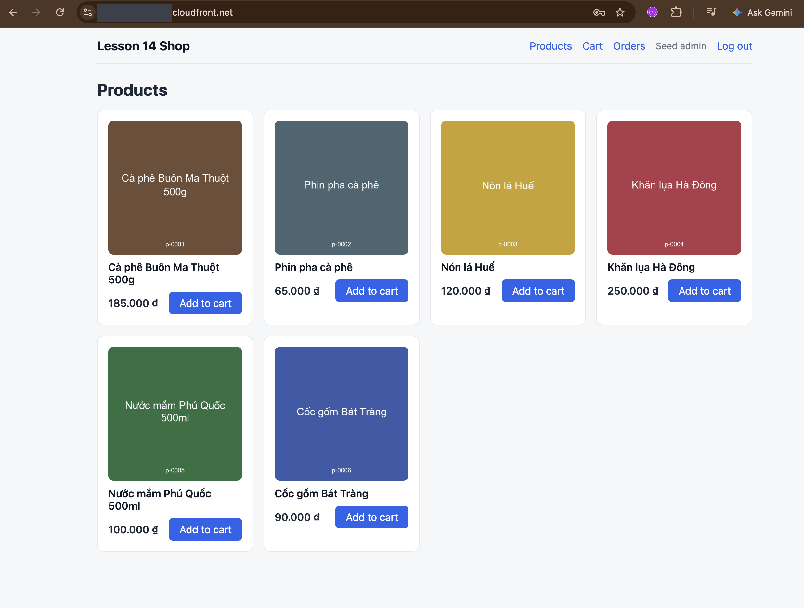 | 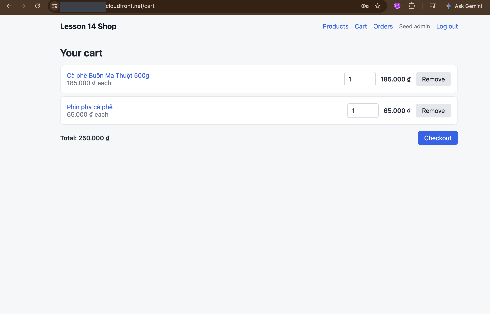 |
| **3. Checkout** | **4. Order paid** |
| 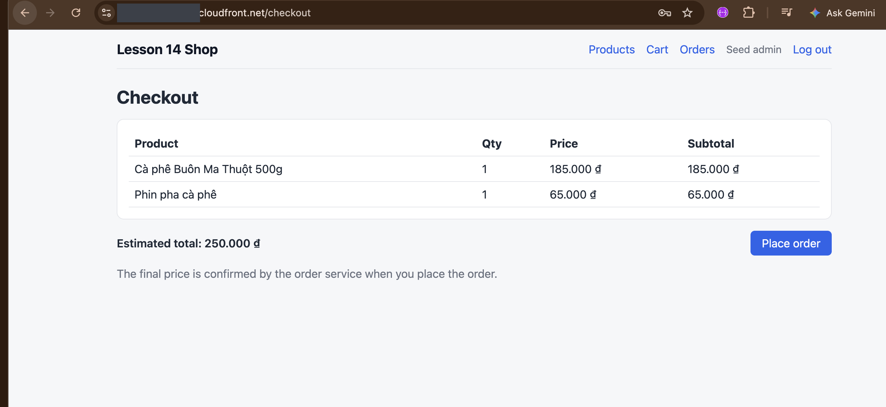 | 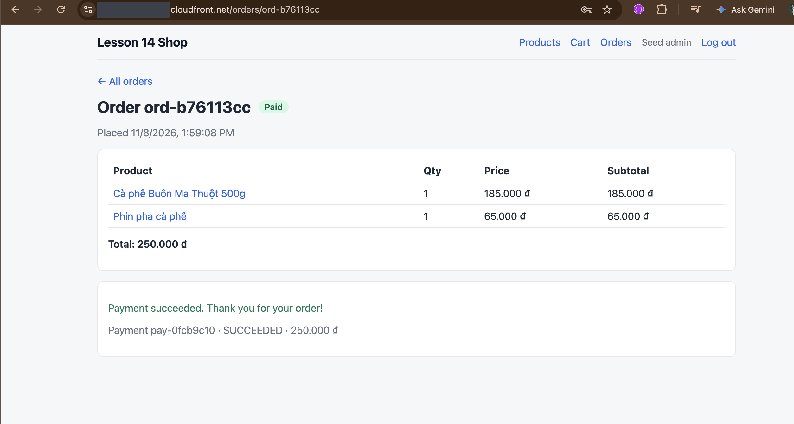 |

**5. The two emails from Notification through SES** (*received*, then *paid*, both at 13:59):

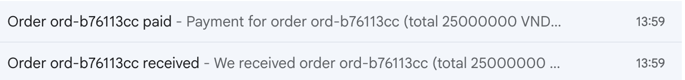

The same order in the service logs, from checkout to the second email in 0.4 s:

| Time (UTC+7) | Service | Log message |
| --- | --- | --- |
| 13:59:08.96 | order | `order created`, `total_cents` 25000000 |
| 13:59:09.05 | payment | `payment recorded`, `pay-0fcb9c10`, `SUCCEEDED` |
| 13:59:09.10 | order | `order status updated`, `PAID` |
| 13:59:09.16 | notification | `notification sent`, `OrderCreated` |
| 13:59:09.34 | notification | `notification sent`, `PaymentSucceeded` |

### Compute and messaging

**ECS:** cluster `lesson14-dev` runs all six services on Fargate, 6 tasks running and none pending.

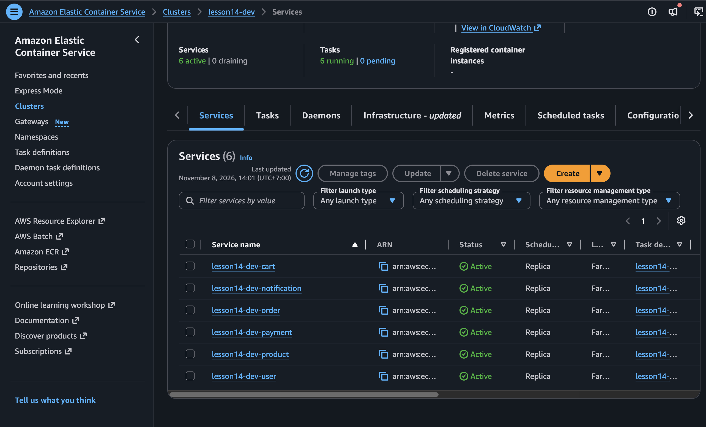

**SQS:** one queue per consumer, each with its own dead-letter queue, all encrypted (SSE-SQS). Every queue shows 0 messages: all events were processed and nothing failed into a DLQ.

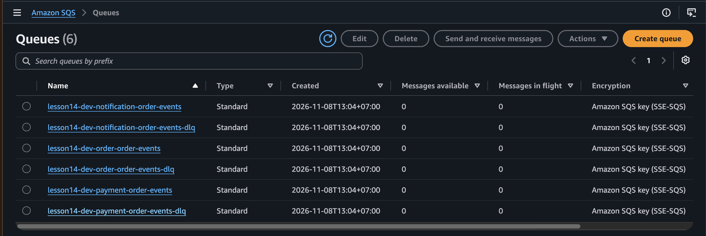

**SNS:** the three SQS queues are confirmed subscribers of the `order-events` topic (each with its `event_type` filter policy), and the ops alarm topic has a confirmed email subscription.

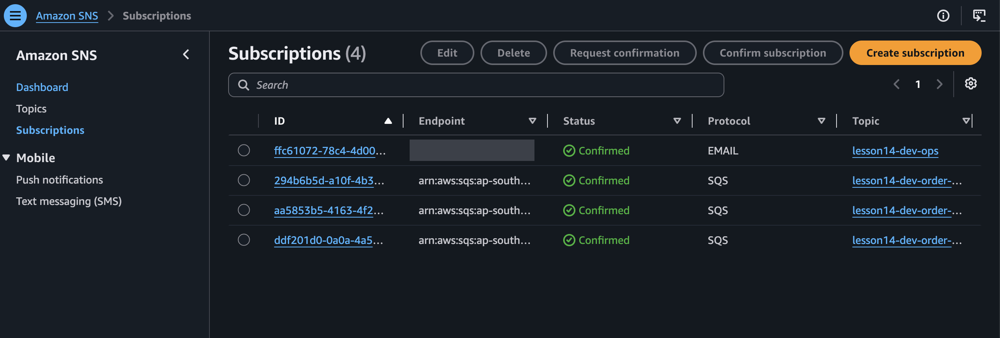

### Security

**WAF:** the `lesson14-dev` web ACL on CloudFront runs the two AWS managed rule sets and the per-IP rate limit (the two `CreatedByCloudFront…` web ACLs in the list are not part of this stack).

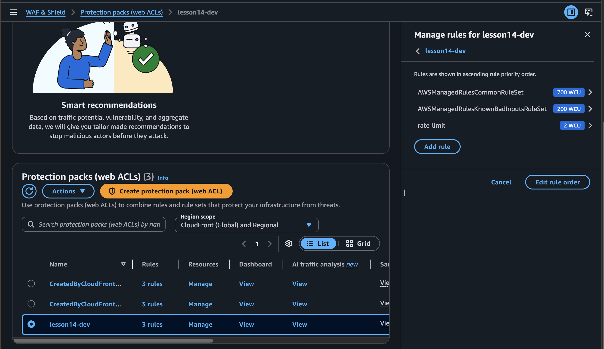

**Cognito:** the user pool holds the demo customer, created by `seed.sh`, with a verified email.

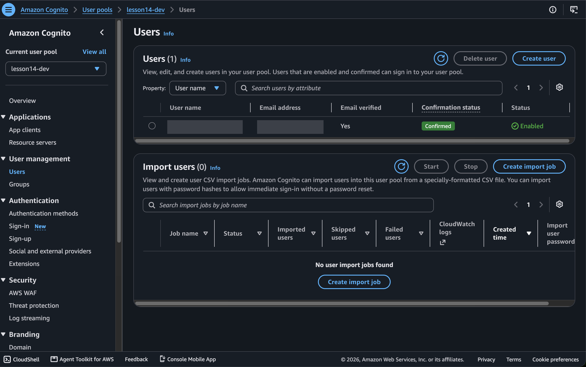

**Masked logs:** in CloudWatch, the customer ID and client IP show as `*****` ([TC-08](testcases.md#tc-08-personal-data-is-masked-in-logs)):

```text
/ecs/lesson14-dev-cart        {"service":"cart","***************************************************","method":"GET","path":"/api/cart","status":200}
/aws/apigateway/lesson14-dev  {"routeKey":"POST /api/users/login","sourceIp":"**************","status":"200"}
```

## Project layout

```text
app/                  Go module: six services, db-init, localbus, compose.yaml
storefront/           Nuxt 4 static SPA, uploaded to S3
terraform/bootstrap/  S3 state bucket (run once)
terraform/environments/dev/  The stack, composing all 14 modules
terraform/modules/    14 modules, each with a README and mocked tests
scripts/              build-push, run-db-init, seed, check-release
seed/                 Demo products and images
images/               Architecture and network diagrams, plus screenshots/ from the live run
testcases.md          Scenario tests on the live stack
ci/                   Sample GitHub Actions pipeline (not wired)
```

> [!CAUTION]
> The stack is billed hourly (about $4/day). It includes a NAT gateway, RDS, an ALB, six Fargate tasks and WAF. Always [clean up](quickstart.md#12-cleanup) when you finish, and never commit `*.tfstate`, `*.tfvars` or `dev.backend.hcl`.
